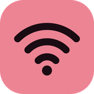
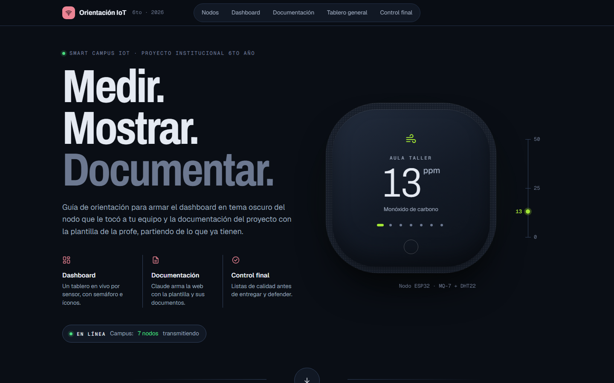
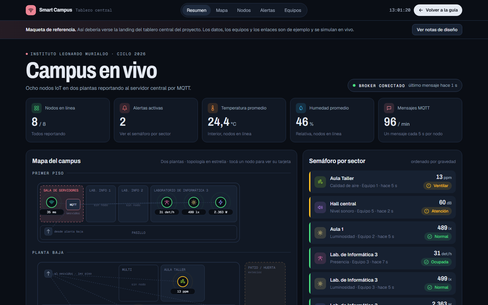

<p align="center">
  
</p>

<h1 align="center">Orientación Proyecto IoT · 6to año 2026</h1>

<p align="center">
  Guía para diseñar el dashboard de cada nodo y documentar el proyecto institucional <strong>Smart Campus IoT</strong>.
</p>

<p align="center">
  
  
  
  
  
  
</p>

<p align="center"><strong>Temas que enseña la guía</strong></p>

<p align="center">
  
  
  
  
  
</p>

---

## Enlaces

**Sitio publicado**<br>
https://lpedaci.github.io/sexto-proyecto2026-orientacion/

**Tablero central (maqueta)**<br>
https://lpedaci.github.io/sexto-proyecto2026-orientacion/tablero-general.html

**Plantilla oficial de documentación** (Pedaci, 2026)<br>
https://lpedaci.github.io/sexto-proyecto2026/

---

## Vista previa

| Guía de orientación | Tablero central |
|---|---|
|  |  |

## Sobre el proyecto

Sitio de orientación para el Proyecto Institucional **Smart Campus IoT** (6to año, Informática). Acompaña a los equipos en dos producciones: el **dashboard en tema oscuro** del nodo que le tocó a cada uno y la **documentación técnica** del proyecto, armada sobre la plantilla oficial.

---

## Propósito pedagógico

| | |
|---|---|
| **Destinatarios** | Estudiantes de 6to año organizados en equipos, uno por nodo IoT. Docentes de los laboratorios de Hardware, Sistemas Operativos, Aplicaciones y Desarrollo de Software. |
| **Problema que resuelve** | Los equipos tienen la parte técnica (ESP32, sensores, MQTT) pero les falta un criterio claro para diseñar la visualización y para ordenar la documentación. |
| **Enfoque** | Aprender viendo un ejemplo que funciona. Cada concepto se muestra en un tablero que se puede tocar, y cada recomendación aclara para qué sirve. |
| **Resultado esperado** | Un dashboard legible y accesible por nodo, un tablero central que reúne a todos y una carpeta de proyecto publicada en GitHub Pages. |

### Secuencia sugerida para el aula

1. **Exploración (15 min).** Cada equipo elige su nodo en la galería y recorre la demo. Prueban "Ver anatomía" y "Simular desconexión".
2. **Análisis (20 min).** Leen la anatomía y la tabla de umbrales y la comparan con lo que miden sus sensores. Ajustan los umbrales y buscan fuentes que los justifiquen.
3. **Producción (2 a 3 clases).** Construyen el dashboard propio. Pueden usar el prompt de la sección A.6 para una primera versión, que después tienen que poder explicar y defender.
4. **Integración.** El Laboratorio de Aplicaciones arma el tablero central tomando como referencia `tablero-general.html`.
5. **Documentación.** Siguen la Ruta B: si tienen documentos, los pasan a la plantilla con ayuda de Claude; si no, completan la plantilla a mano.
6. **Control de calidad.** Antes de la entrega recorren las dos listas de control. Cada uno puede tildar lo revisado y su avance queda guardado en su navegador.

---

## Contenido del sitio

### `index.html` · Guía de orientación

| Sección | Qué enseña |
|---|---|
| **Hero** | Un nodo ESP32 dibujado como producto, que va mostrando las lecturas en vivo de los 7 sensores, con una escala vertical. Presenta el tema antes de la primera explicación. |
| **0 · Los nodos** | Galería de los 7 nodos (aire, luz, ruido, presencia, consumo, suelo, red). Al elegir uno, se ajustan la demo y los prompts de toda la guía. |
| **A · Dashboard** | Demo en vivo, anatomía en 6 piezas, semáforo de umbrales, 8 reglas de tema oscuro, paleta para copiar, íconos SVG para copiar, conexión por MQTT (JSON, Arduino, MQTT.js y Mosquitto) y prompt para Claude. |
| **A+ · Tablero central** | Qué tiene que tener la landing institucional, con una vista previa y el enlace a la maqueta. |
| **B · Documentación** | Una bifurcación: "ya tenemos documentos" lleva al camino con Claude y a un prompt que se completa solo; "arrancamos de cero" lleva al paso a paso manual. Cierra con el mapa de los 17 apartados de la plantilla. |
| **QA · Control final** | Dos listas de control, una para el dashboard (12 ítems) y otra para la documentación (10). |
| **Referencias** | Fuentes en formato APA 7. |

**Navegación.** Además del menú superior, al bajar del hero aparece un índice lateral con barra de progreso y la sección activa marcada. En pantallas de menos de 1300 px el índice se abre desde un botón flotante.

### `tablero-general.html` · Maqueta del tablero central

Es la landing de referencia que reúne a todos los nodos en tiempo real, con datos simulados. Está ordenada para responder, en este orden, qué pasa, dónde, en qué nodo, cuándo y quién está a cargo:

1. **Resumen:** nodos en línea, alertas activas, promedios del campus y mensajes MQTT por minuto.
2. **Mapa del campus en dos plantas:** el primer piso tiene la sala de servidores y los laboratorios de Informática; la planta baja tiene Multi, Aula Taller, Hall central, las aulas y el patio exterior. Los nodos se ven coloreados por estado y unidos al servidor en estrella.
3. **Semáforo por sector:** ordenado de peor a mejor.
4. **Tarjetas de nodo:** cada una con acceso al dashboard del equipo.
5. **Mapa de calor:** cada nodo en las últimas 24 horas.
6. **Alertas en vivo.**
7. **Equipos y accesos:** dashboard, documentación y código de cada equipo.

El botón **"Ver notas de diseño"** numera cada bloque sobre la página. Sirve para analizar la maqueta en clase.

---

## Decisiones de diseño UX/UI

### Sistema visual

- **Tema oscuro único y deliberado.** El tema oscuro es lo que se enseña, y el sitio lo usa en todas sus pantallas. Los neutros tienen un leve tono azul (`#0A0E15` de fondo, superficies que se aclaran por capas) y el texto nunca es blanco puro (Google, s.f.).
- **Un solo color de acento.** Se usa el bordó rosado `#EC8494`, la identidad de Info A, el mismo que la plantilla en modo oscuro. Queda reservado para marca, foco, estado activo y llamadas a la acción.
- **Colores por variable.** Cada variable sensada tiene un color fijo que se repite en la tarjeta, el gráfico, el mapa y la leyenda. Esos colores no se usan para estados.
- **Semáforo independiente del acento.** Verde, amarillo y rojo se usan solo para estados, y siempre van acompañados de una palabra y un ícono.
- **Tipografía.** *Archivo* en ancho condensado para los títulos y los valores grandes, *Geist* para el texto y *Geist Mono* para datos, tópicos y etiquetas. Los dígitos son tabulares en todo lo que se actualiza en vivo.

### Arquitectura de la información

- **Del resumen al detalle:** primero el estado, después el valor y por último la historia (Few, 2013).
- **Visibilidad del estado del sistema:** cada dato muestra cuándo llegó ("hace 4 s") y un nodo sin datos se presenta como tal, nunca como un cero (Nielsen, 2024).
- **Estados vacíos diseñados:** "sin alertas", "sin datos" y "nodo desconectado" tienen su propio mensaje.

### Accesibilidad

Se apunta al nivel AA de las pautas WCAG 2.2 (World Wide Web Consortium, 2023):

- Contraste de texto de 4,5:1 o más.
- Foco de teclado visible en todos los controles.
- Los nodos del mapa se pueden recorrer y activar con el teclado.
- Los botones de alternancia usan `aria-pressed` y las pestañas y regiones en vivo usan los roles ARIA correspondientes.
- Se respeta `prefers-reduced-motion`: sin animaciones, sin rotación automática y con desplazamiento sin suavizado.
- El diseño es responsive desde 360 px, sin scroll horizontal. Solo las tablas, los planos y el código se desplazan dentro de su propio contenedor.

---

## Arquitectura técnica

- **HTML, CSS y JavaScript sin frameworks ni paso de compilación.** El contenido fijo está en el HTML, los estilos en `assets/css`, y la lógica y los datos en `assets/js`, cada uno en su archivo. Lo que se publica en GitHub Pages es exactamente lo que está en el repositorio.
- **Scripts clásicos con un espacio de nombres.** Todo cuelga de `window.SmartCampus` (`util`, `iconos`, `guia`, `tablero`). No se usan módulos ES para que las páginas también funcionen abiertas directamente desde el disco.
- **Sin dependencias en tiempo de ejecución.** Lo único externo son las fuentes de Google Fonts, que tienen tipografías del sistema como respaldo.
- **Gráficos en SVG generados a mano:** sparklines, áreas con franjas de umbral, medidor semicircular, plano del campus y mapa de calor.
- **Datos simulados.** Se generan con un generador pseudoaleatorio con semilla y curvas diarias propias de cada sensor (recreos, horario de clase, riego), así que las demos son verosímiles y se pueden repetir.
- **Persistencia local.** Se guarda con `localStorage`, siempre dentro de `try/catch` para que nada se rompa si el navegador lo bloquea:

| Clave | Uso |
|---|---|
| `orient-nodo` | Nodo elegido. También lo comparte el tablero central al tocar "Abrir dashboard". |
| `orient-doc` | Equipo y curso cargados en el prompt de documentación. |
| `orient-check-dash` / `orient-check-doc` | Ítems tildados en las listas de control. |

### Estructura

```
.
├── index.html                  Guía de orientación (rutas A, A+, B y QA)
├── tablero-general.html        Maqueta del tablero central
├── favicon.ico                 Ícono clásico (16, 32 y 48 px)
├── site.webmanifest            Nombre, colores e íconos para instalar el sitio
├── sitemap.xml                 Páginas para los buscadores
├── robots.txt                  Permisos de rastreo
├── .nojekyll                   Publica los archivos tal cual en GitHub Pages
├── .gitignore                  Archivos locales que no se suben
├── README.md
└── assets/
    ├── css/
    │   ├── tokens.css          Paleta, tipografías y medidas
    │   ├── base.css            Reglas comunes a las dos páginas
    │   ├── guia.css            Estilos de la guía
    │   └── tablero.css         Estilos del tablero
    ├── js/
    │   ├── comun/
    │   │   ├── utilidades.js   Selectores, formato, localStorage y series simuladas
    │   │   └── iconos.js       Set único de íconos SVG
    │   ├── guia/
    │   │   ├── datos.js        Nodos, umbrales, reglas, paleta, mapa y listas de control
    │   │   ├── codigo.js       Fragmentos de JSON, Arduino, MQTT.js y Mosquitto
    │   │   ├── prompts.js      Prompts para Claude
    │   │   └── app.js          Demo, selector de nodo, galería y navegación
    │   └── tablero/
    │       ├── datos.js        Nodos, posición en el plano y equipos
    │       └── app.js          Mapa, tarjetas, mapa de calor y alertas
    ├── icons/                  Favicons, ícono de Apple e íconos de Android
    └── img/
        ├── og/                 Tarjetas para compartir (1200 × 630 px)
        └── capturas/           Imágenes de este README
```

### Personalización rápida

| Para cambiar... | Editar en |
|---|---|
| Nodos, sensores, ubicaciones y umbrales de la guía | `assets/js/guia/datos.js` → `NODOS` |
| Nodos del tablero central, posición en el plano y equipos | `assets/js/tablero/datos.js` → `NODOS` y `ORDEN` |
| Plano del campus | `assets/js/tablero/app.js` → `renderMap()` |
| Paleta y tipografías | `assets/css/tokens.css` → `:root` |
| Ítems de las listas de control | `assets/js/guia/datos.js` → `CHECKS` |
| Apartados del mapa de la plantilla | `assets/js/guia/datos.js` → `MAPA` |
| Texto de los prompts | `assets/js/guia/prompts.js` |
| Ejemplos de código de la conexión por MQTT | `assets/js/guia/codigo.js` |
| Íconos de la interfaz | `assets/js/comun/iconos.js` |

### SEO y tarjetas para compartir

Cada página incluye descripción, URL canónica, etiquetas Open Graph y de X, y datos estructurados de schema.org. El sitio suma favicon en SVG, PNG e ICO, ícono para iOS y Android, manifiesto web y mapa del sitio.

Para que Google lo encuentre antes, conviene registrarlo en [Google Search Console](https://search.google.com/search-console) como propiedad de tipo "prefijo de URL" y enviar el mapa del sitio:

https://lpedaci.github.io/sexto-proyecto2026-orientacion/sitemap.xml

Los buscadores solo leen `robots.txt` en la raíz del dominio. En una dirección de proyecto de GitHub Pages ese archivo no se consulta, por eso el mapa del sitio se envía desde Search Console. Queda en el repositorio por si el sitio pasa a tener dominio propio.

Si cambia la dirección de publicación, hay que actualizarla en el `<head>` de cada página, en `sitemap.xml` y en `robots.txt`.

### Desarrollo local

No necesita instalar nada. Alcanza con abrir `index.html` en el navegador, o servir la carpeta para probar los enlaces entre páginas:

```bash
python3 -m http.server 8000
```

### Publicación

En el repositorio: **Settings → Pages → Deploy from a branch → `main` → `/ (root)` → Save**.

---

## Relación con el proyecto institucional

| Esta guía | Plantilla de documentación |
|---|---|
| Nodos y sensores (aire MQ-7, luz BH1750, ruido KY-037, presencia PIR, consumo SCT-013, suelo capacitivo, red RSSI + ping) | Apartado 12 · Componentes |
| Umbrales del semáforo | Apartado 13 · Diseño de la aplicación |
| Tópicos `campus/{sector}/{nodo}/telemetria` | Apartado 10 · Arquitectura del sistema |
| Prompt de documentación | Estructura de `assets/js/datos.js` y de los 17 apartados |

Los umbrales son valores de referencia escolares. Cada equipo debe justificar los suyos con fuentes citadas en APA 7.

---

## Referencias

Few, S. (2013). *Information dashboard design: Displaying data for at-a-glance monitoring* (2.ª ed.). Analytics Press.

Google. (s.f.). *Dark theme*. Material Design 2. Recuperado el 2 de noviembre de 2026, de<br>
https://m2.material.io/design/color/dark-theme.html

Nielsen, J. (2024, 30 de enero). *10 usability heuristics for user interface design*. Nielsen Norman Group.<br>
https://www.nngroup.com/articles/ten-usability-heuristics/

OASIS. (2019). *MQTT version 5.0* [Estándar OASIS].<br>
https://docs.oasis-open.org/mqtt/mqtt/v5.0/mqtt-v5.0.html

Pedaci, L. (2026). *Smart Campus IoT: Documentación* [Plantilla web].<br>
https://lpedaci.github.io/sexto-proyecto2026/

World Wide Web Consortium. (2023). *Web Content Accessibility Guidelines (WCAG) 2.2*.<br>
https://www.w3.org/TR/WCAG22/

---

**Autoría:** Lourdes Pedaci · Proyecto Institucional 6to año 2026 · Instituto Leonardo Murialdo.
